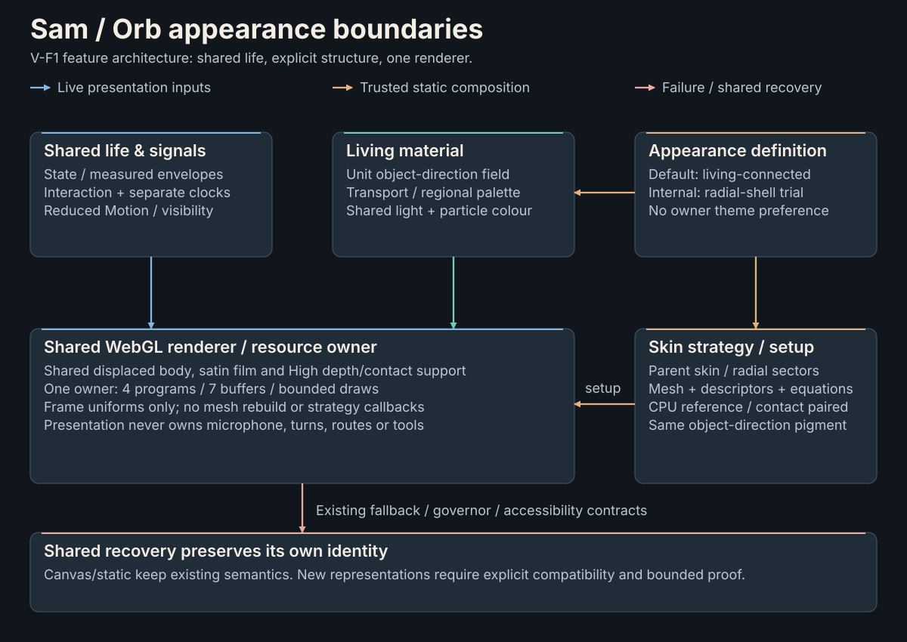

# Orb appearance foundation — V-F1

Isolated [V-F5](BIPOLAR_SEPARATION_VF5.md) adds one closed `opaque-depth`
strategy flag for the existing bipolar positive peels: six color ranges write
ordinary per-fragment depth with blending disabled at all tiers; particles restore
premultiplied blending. Other strategies retain their film shaders/draw behavior.
No new framebuffer, resource owner, signal authority or appearance selector.

Current follow-up: [V-F4](BIPOLAR_PEEL_VF4.md) adds internal polar trajectories and
an explicit parameter-atlas/material-direction mapping after owner rejection of
V-F3's leaves/patches. The V-F1 diagram and numerical tables below describe their
historical checkpoint, not an exhaustive current strategy list. Default is unchanged.

Current follow-up: [V-F3](ORGANIC_PEEL_VF3.md) closes the strict radial numerical
gap and adds a separately selectable positive-peel experiment after owner rejection
of V-F2 morphology. This V-F1 record remains historical; parent remains default.

Follow-up: [V-F2 hosted graphical evidence and numerical investigation](RADIAL_SHELL_PROOF_VF2.md)
supersedes this checkpoint's unexecuted-shader/build disposition on the isolated
feature branch. The V-F1 baseline evidence below remains historical and intact.

2026-10-23. Isolated `feature/orb-appearance-foundation`, based on clean dev
`cc69bc2b90eac4068c929af4beb1bb95705b14af`. CPU/source engineering only; no
shader execution, rendering, performance or owner acceptance.

## Starting audit and compatibility checkpoint

V-E closure contains only its intended docs/evidence/assets. All 68 final source
inputs and five artifacts match its recorded clean `d8c376e` build. No source input
changed after that build. No V-E omission is established. Local `origin/dev` matches
`cc69bc2`; no remote query or mutation is needed for this assignment.

Before changing the renderer, a CPU test captures SHA-256 snapshots of the five
exported body/skin/particle-vertex shader strings, all tier skin arrays, ranges,
boundaries and packed descriptors at seed `0x5a17`. The initial capture referenced
a non-exported particle fragment by mistake; the fixture was corrected before any
renderer edit, and only the successful baseline capture is evidence.

`appearance.ts` owns closed, typed appearance/material definitions. `skin-strategy.ts`
owns a setup-only geometry/descriptors/equations/contact contract plus a CPU reference.
WebGL still owns programs, buffers, draws and cleanup. `VisualEngineOptions.appearance`
is an internal engineering seam, carried through quality rebuilds, with no saved
setting or owner selector. Unknown IDs fail explicitly; Canvas/static are shared
recovery, not an experimental-shape emulation. Diagnostics distinguish that path.

The default `living-connected` delegates existing connected skin mechanics without
changing equations, seed, topology, offsets, material or motion. The snapshot passes
after modularization. The initial focused batch has 26 passing compatibility,
engine/fallback and mock-resource cases; mock GL is not shader execution.
The initial Node-crypto import also failed the existing browser-oriented test type
configuration; Web Crypto supplies the same SHA-256 proof without adding declarations
or dependencies. Later tuple/lint findings were corrected before final checks.

## Boundaries and extension rules

This is a source-architecture diagram, not an Orb image. Its editable generator is
[`generate_visual_subsystem_diagram.py`](../scripts/generate_visual_subsystem_diagram.py).
XML/accessibility, node bounds, connector endpoints/routes and generator reproduction
are checked without rasterization or visual acceptance. The two public diagrams stay
unchanged. Generate/check this additional diagram with
`python -m scripts.generate_visual_subsystem_diagram [--check]`.

| Owner | Responsibility | Extension boundary |
| --- | --- | --- |
| Input adapter / MotionEvaluator / interaction | Lifecycle projection, measured envelopes, independent clocks, drag, reduced/hidden behavior | Appearances consume the same frame; no microphone, turn, routing, tools or cancellation authority |
| `appearance.ts` | Closed internal IDs; explicit material/structure pairing and shared recovery contract | Add a reviewed built-in definition, not an untrusted object, registry or persisted theme setting |
| Living material / field / palette / particles | Existing two transports, three regional banks, coherent object-space pigment, light hierarchy and particle coordination | Both implemented skins use the same material object and original unit object direction |
| `skin-strategy.ts` / radial modules | Immutable setup arrays, packed descriptors, vertex/contact sources and CPU reference | Change geometry and matching math/contact together; keep the vec3-direction/Uint16/six-range contract and maximum three descriptors or explicitly revise it |
| `webgl.ts` | Static composition, quality programs, buffers, blend/depth, sorting, uniforms and disposal | One engine/resource ledger; no strategy callbacks or mesh construction in the frame loop |
| VisualEngine / Canvas/static | Quality rebuild/governor, visibility, accessibility, recovery | Preserve internal choice through rebuilds; fallback has shared recovery identity and reports that distinction |

Default hashes remain unchanged after refactoring. The only default-path differences
are an optional internal constructor/factory argument, two diagnostic fields and CPU
skin setup before program allocation (invalid setup fails before program/buffer allocation).
The default composed shader object is frozen/reused. Geometry equations, uploads,
palette, input semantics, clocks, quality caps, saved settings and ordinary default
selection stay intact. No shader is dynamically downloaded or supplied by the owner.

Future lava/gold/rainbow palette treatments can add an explicit material variant while
coordinating body, film and particle colour; they still need colour/readability proof.
Molten shape/glow is not promised by changing a palette. Wireframe needs an explicit
line/edge or barycentric representation and pass-cost decision. Smoke/cloud/fractals
may need another bounded rendering representation and are incompatible with this
surface contract until separately designed/proven. Painterly/synthwave/dark/HAL-like
directions remain requirements, not implementations. Eleven future styles are retained;
this work implements no theme selector or universal appearance/plugin framework.

## Experimental radial-sector construction

Internal ID `radial-shell-experimental` selects `radial-sectors`; `living-connected`
still selects `connected-parent`. Four unequal meridional chart spans share one
oblique spherical axis; three contain broad rounded, asymmetrically perturbed angular
sector windows. The fourth and both polar caps remain attached. Structured annular
rows meet common chart edges at actual welded indices; caps end in nondegenerate
pole fans. This is one orientable sphere minus three disks, not three detached shells:
one component, three boundary loops and Euler characteristic -1 at every tier.

The free boundary is a smooth perturbed superellipse in azimuth/latitude coordinates.
Its derivative and the spherical gradient give the local inward normal. A collar
coordinate runs from attached q=0 to free rim q=1, extending to 1.1 only for differential
samples. Radial lift starts quadratically and curl cubically, preserving a C1 resting
hinge. Tangential return points away from the window and the permitted rim arc is at
most 1.03 radians. Existing measured speech/receptive/work/recovery signals and the
membrane clock modulate the same law; body radius gains are unchanged.

The first numerical pass found an inward-facing free-rim normal (-0.0339 radial dot)
at compact radius 0.46. A shallower arc and return radius (0.45 times local lift height)
repair that tangential-Jacobian failure in CPU and GLSL together. The original positive
normal assertion stays; additional seed/full-clock samples pass. This is an internal
prototype correction, not a criticism of an owner-seen renderer or optical acceptance.

`SKIN_SURFACE_GLSL` and complete-surface tangent-sampled normals are reused. The map
rests on the unchanged displaced living body with the same tier clearances. Vertex
pigment coordinates remain the original unit object direction, never deformed world
position or chart UV. High contact uses the new angular-window packing/collar width;
no old opening parameters are interpreted as radial ones. Contact is still an ambient
proxy, not a cast shadow or collision solver. Shared satin/front-back response,
premultiplied blending, six-range sorting and the High opaque-interior pass remain.

## Geometry/resource comparison

N is samples per chart side, R radial rows (4/8/16). The radial layout requires even
R and has `20*N*R - 1` vertices and `4*N*(10*R - 3)` triangles; current connected skin
has `24*N*R - 1` and `4*N*(12*R - 3)`. Both have 12*N boundary edges, the same three
holes and six setup ranges. Caps consume R/2 intervals. Uint16 indexing and a shared
20,000 body-plus-skin vertex guard bound setup arrays; no frame remeshing occurs.

| Tier | Parent → radial skin vertices | Parent → radial body+skin vertices | Parent → radial body+skin triangles | Parent → radial geometry bytes |
| --- | ---: | ---: | ---: | ---: |
| Low | 575 → 479 | 1,136 → 1,040 | 2,040 → 1,848 | 32,988 → 30,684 |
| Medium | 2,303 → 1,919 | 5,004 → 4,620 | 9,504 → 8,736 | 150,252 → 141,036 |
| High | 9,215 → 7,679 | 17,600 → 16,064 | 34,272 → 31,200 | 519,500 → 482,636 |

Bytes above are actual body/skin vertex/index arrays plus particle arrays, excluding
the unchanged 44-byte halo. Four descriptor vec4[3] arrays use 192 bytes; pose/phase/
clearance/count make 224 bytes per program, duplicated for High body contact (448).
Draws remain 9/9/10, particles 12/24/64, programs four, buffers seven. All fit the
existing 1.5 MiB geometry/uniform envelope. Bounded setup staging arrays/weld maps,
JS/shader strings and driver residency are not measured heap/VRAM figures. Angular
trigonometry/power and fragment coverage can cost more despite fewer vertices.

## Proof, comparison entry points and remaining gates

The prototype checkpoint passes 53 focused CPU/Node cases, including compatibility,
topology/deformation, engine rebuild/fallback and mock resource setup/disposal.
Tests exhaust every indexed rest triangle/edge and every deformed triangle's finite
area in six poses at radii 0.46/0.83/1.18. Differential orientation is sampled, not
an interval proof. Hinge/rim continuity, analytic boundary derivatives, seed/clock
wraps, float32 descriptor quantization, contact bounds, Surface Flow independence,
Reduced Motion and zero Audio Reactivity receive separate checks. Mock draws prove
resource calls, not successful GPU compilation or rendered images.

The existing isolated fixture accepts `appearance` alongside quality/material/debug
options, so later authorized comparisons can use
`fixture("high", { appearance: "radial-shell-experimental" })` versus `living-connected`.
`proveSkinGPU(appearance)` selects the actual paired production shape/surface sources
and CPU reference, retaining 192 controlled point/normal samples. It is authored and
type-checked only; its controlled spheroid does not prove the real body/material shader.
Use seed `0x5a17`, yaw 0/0.75/1.6, controlled curl 0/6/12 seconds and palette samples
0/15/45/120/300 seconds with identical framing/light/exposure/unrelated clocks.

Later gates: compile/link both strategies; run transform feedback; inspect full colour
before neutral/attachment/normal/depth views; inspect compact and idle/listening/thinking/
speaking/recovery poses across tiers, reduced motion and fallback; then measure matched
isolated GPU/CPU submission cost. No such execution is authorized here. Unknowns include
sector/casing character, rounded-rim silhouette, Low faceting, rest clearance, chart
sorting/soft overlap, actual body contact and shader/fill cost. Numeric validity does
not show attractive radial shells, collision freedom or human acceptance. Do not make
the prototype default or merge/push this branch before separately authorized comparison.

## Final source checkpoint

Two nonoverlapping sequential Node batches pass **174 distinct cases in 23 files**:
77 geometry/renderer cases and 97 field/palette/motion/input/lifecycle cases. They
include 18 radial cases, the unchanged baseline snapshot, all tier mock resource
paths, hidden/fallback/governor behavior and playback/presence contracts. The earlier
26/53-case batches overlap and are not added. TypeScript project checking and Biome
on 16 changed TS/test files pass. **38 scoped Python cases** cover the new diagram,
requirements and existing documentation checks; Ruff checks/formats two changed files.
All 66 requirement IDs/eleven future styles and priority bands remain intact.

Review confirms no runtime/protocol/session/audio/provider changes, dependency or
version changes, new uniforms/draw passes, global registration, external resources
or changed default equations. Source-level CPU/GLSL review covers packing, angular
derivatives, arc coefficients, contact collar lookup, differential normals and shader
composition. It does not replace GPU compilation/transform feedback. The single
production build and final input/artifact fingerprints follow after committing this
source checkpoint, so its source identity is recoverable and clean.

## Build and closure

The source checkpoint is `7f5101eab088d680b0e8379a64f7e4d3de7a3885`, following
foundation commit `f408918`. One low-priority canonical `tsc -b && vite build`
passes without warnings or installs (3.99 seconds total; Vite 827 ms/91 modules).
All **73 inputs** match the clean build, LF digest
`e95e1edc6e5f68b3d1b99b142ba5fabab153c7ba09f355d655c1cb52dd33c73b`.
The entry is `index-BoytXu27.js` (415.63 kB / 124.72 kB gzip) with unchanged
`index-Brem5iPs.css` (20.44 kB / 5.37 kB gzip). Against the V-E integration bundle,
this is about +10.75 kB JS / +3.39 kB gzip; default equations remain byte-identical.
No implementation input changes after this build. Both internal IDs and the radial
equations exist in the bundle, but ordinary construction still selects the parent skin.

Evidence: [checks and boundaries](evidence/orb-appearance-vf1/validation.json),
[resource comparison](evidence/orb-appearance-vf1/geometry-comparison.json) and
[input/artifact hashes](evidence/orb-appearance-vf1/frontend-assets.json).
The closure checks re-read final source/assets, distinct-test reports, requirements,
documentation links and the generated SVG. They do not launch or render anything.
Existing V-E, public SVG and historical visual evidence stay intact. No runtime,
model/provider, speech device, browser, GPU, packaging, network or human beta runs.

The feature branch remains local and separate from dev `cc69bc2`; its default-path
architecture is suitable for integration review after authorized shader/regression
gates. The radial prototype is suitable for controlled comparison, not default
promotion or artistic acceptance. Keep this feature branch for that later work and
retain dev as the recoverable integration baseline. No V-F2 is begun here.
