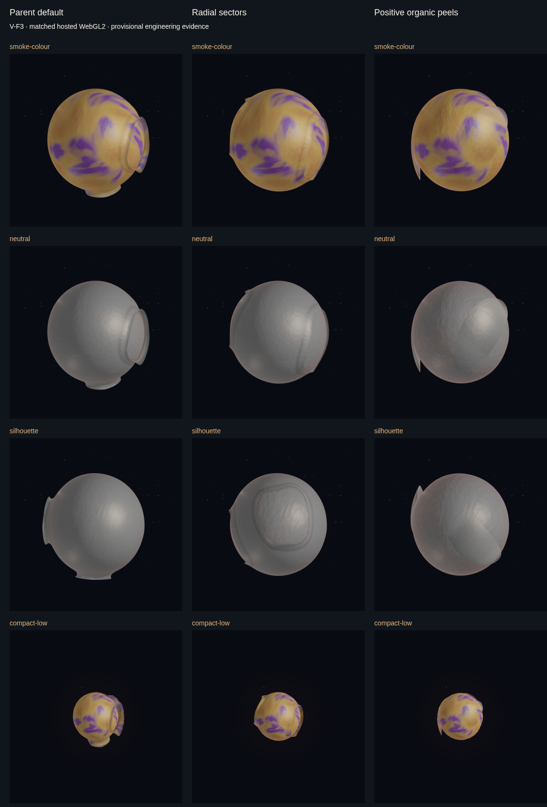

# Organic peeling geometry and focused experience refinement — V-F3

Starting feature HEAD `653ca9261a79bc7308c93fc0fa262e87b1133733`; integration
dev remains `cc69bc2b90eac4068c929af4beb1bb95705b14af`. Published v0.2.5 is
`dc64c5d180fb44cf7a29bf4d0d1ae2f853347709`. No default promotion or merge.

## Current disposition

The strict radial numerical defect is fixed. Positive organic peels are an actual,
CPU-checked and software-WebGL2-executed internal alternative with broad roots,
outward curvature and moving geometry. They remove circular window collars and
reduce disproportionate compact tips. **Front views still have rounded/leaf-like
contours; this is not a demonstrated final artistic success or a default promotion.**
Parent remains ordinary default. Shared pigment, clocks, 12/24/64 caps and all core
authority remain unchanged. Console/Memory and loading refinements pass focused
and synthetic hosted checks. Supported hardware, whole motion, real owner-window
use and owner acceptance remain open. No local graphical/app/provider/audio run.

Final [hosted proof](https://github.com/AlfonsoFR2020/sam-ambient/actions/runs/40014803644)
at `7bb75fb95da53a537fdb38fa672b8ee2904bf05d` passes all five browser tests,
including expanded free-boundary coverage and actual run-URL emission.
The [integrity manifest](evidence/orb-vf3/integrity.json) binds retained files,
matched inputs and source identifiers; early failures remain intact.

| Inspect | Final full-resolution path |
| --- | --- |
| Ordinary colour, yaw 0 / curl 0 | [720px](evidence/orb-vf3/40014803644/colour-yaw0-curl0-organic-peel-experimental.png) |
| Colour, yaw 1.6 / curl 12 | [720px](evidence/orb-vf3/40014803644/colour-yaw1.6-curl12-organic-peel-experimental.png) |
| Neutral / side curvature | [neutral](evidence/orb-vf3/40014803644/neutral-organic-peel-experimental.png), [side](evidence/orb-vf3/40014803644/silhouette-organic-peel-experimental.png) |
| Free rims / normals / depth | [attachment](evidence/orb-vf3/40014803644/attachment-organic-peel-experimental.png), [normals](evidence/orb-vf3/40014803644/normals-organic-peel-experimental.png), [depth](evidence/orb-vf3/40014803644/depth-organic-peel-experimental.png) |
| Fixed yaw .75, phase 0 versus 6 | [phase 0](evidence/orb-vf3/40014803644/phase0-organic-peel-experimental.png), [phase 6](evidence/orb-vf3/40014803644/smoke-colour-organic-peel-experimental.png) |
| Compact Low | [720px](evidence/orb-vf3/40014803644/compact-low-organic-peel-experimental.png) |
| Actual React synthetic controls | [loading](evidence/orb-vf3/40014803644/ui-loading.png), [Console](evidence/orb-vf3/40014803644/ui-console.png), [Memory](evidence/orb-vf3/40014803644/ui-memory.png), [narrow](evidence/orb-vf3/40014803644/ui-memory-narrow.png) |

These fixtures use current source with committed production-input verification,
not a full Sam/owner session. UI scenes deliberately retain the ordinary parent.
No reference board is fabricated; the original repository logo is the available image.

## Initial source checkpoint (historical; superseded by the evidence below)

The owner rejects V-F2's parent/radial morphology as flat, panel/island/casing-like.
That new artistic evidence does not reject the successful evolving pigment. The
repository `sam-logo.png` was inspected; the missing concept board remains unavailable.

Internal `organic-peel-experimental` adds three unequal, curved, tapered positive
lobes. Each is a gnomonic disk on the unchanged displaced body. A broad root rests
on that body; quadratic lift and cubic tangential bend start with zero first
derivative at the hinge. There is no circular rolled lip. Original unit directions
remain the shared pigment domain. Motion uses the existing membrane clock,
coherence and measured lift without new input authority.

This deliberately tests **three topological disks with broad body attachment**,
instead of another perforated complete coat. The common body provides material
continuity, but the film mesh is not globally connected. This consequential,
reversible interpretation is permitted by V-F3 and needs graphical/owner judgment.
Six draw ranges split the three lobes for existing sorting; descriptor sizes are
unchanged. No per-frame geometry work, extra program, framebuffer or draw is added.

`living-connected` remains the ordinary default. Default shader/geometry snapshots
pass; parent and radial remain internally selectable. No appearance preference,
palette change, radius-response gain or theme is introduced.

Particle experiments retain released 64 as baseline and compare near-field
64/128/256 with the same shader/draw. Smaller, softer, less distant motes use an
eight-bit radial distribution. No population increase is accepted on memory cost
alone; visible gains and hardware performance are separate gates.

Console/Memory share a presentation-only button/header component. Existing owner
capability commands, reviewed-Memory semantics, disabled states and close/focus
callbacks remain. CSS reduces the startup summary and unifies nonmodal panels;
required model choice and failures remain visible.

The existing sandboxed hosted workflow is reused for a bounded three-strategy
matrix, particle alternatives, numerical intermediate trace and synthetic UI
interaction. No local graphical execution is permitted or performed. Actual
results and final disposition follow after evidence, not from this source checkpoint.

## First actual comparison and evidence-led correction

[Run 40010281390](https://github.com/AlfonsoFR2020/sam-ambient/actions/runs/40010281390)
retains all 27 geometry views, four particle comparisons and four UI screenshots in
[its evidence directory](evidence/orb-vf3/40010281390). Four UI interaction tests pass;
the graphical test fails solely on the unchanged strict radial position guard.
Parent and positive-peel proofs pass (192 samples each); peels have max position
error .0000069374 and normal error .0001304003. All three render through WebGL2.

The new positive peel removes circular window rims and has clear lifted silhouette,
but its fronts are still rounded/leaf-like and several tips form an upright crown.
These negative images are retained. One bounded refinement lengthens/asymmetrically
curves the domains, reverses one peel's direction and varies the sweep. Low uses
six radial rows instead of four to support the longer curve. It remains a candidate,
not an accepted default; a second matched render must judge the result.

The actual shader trace at the old worst sample shows sin(1.7000000477) = .9914833307
instead of .9916648043 and cos = -.1288278699 instead of -.1288445416. Pair length
is .999817891. The fourth-power superellipse turns this nonunit pair into a
.0001162006 rim error, then .000581 collar error. The quarter-power's error at the
GPU's own input is only 2.47e-8. The [independent arithmetic record](evidence/orb-vf3/radial-precision-diagnosis.json)
also evaluates packed uniforms and explicit Float32 steps: ordinary rounding with
accurate trig does not explain the measured error. Uniform pair scaling predicts
the dominant rim shift. This identifies the redundant angle/trig reconstruction,
not the quarter-root or chart map, as the significant source on this renderer.

CPU/GLSL now use the normalized chart x/y directly for the rim base, derivative and
gradient. This is the same mathematical direction, without atan-to-sin/cos loss;
it is not a tolerance change or geometry clamp. Shape harmonics and all default
equations stay unchanged. A replay regression protects the measured sensitivity.
The strict .0001 position/.005 normal gates stay mandatory for the second run.

UI screenshots expose a concrete additional defect: an admitted loading snapshot
could display primary **Ready** while the secondary status said Loading. A focused
test first reproduces its missing primary label, then passes after existing lifecycle
labels are retained by the status projection. No readiness authority or state machine
changes. Narrow footer alignment is also corrected from the actual screenshot.

## Second proof and final bounded morphology correction

[Run 40011677649](https://github.com/AlfonsoFR2020/sam-ambient/actions/runs/40011677649)
passes all five browser tests. Its [30 matched views, particle and UI evidence](evidence/orb-vf3/40011677649)
retain the strict radial correction: maximum position error .0000052275, normal
.0002453279. The old fixed sample's q changes from 1.0005810261 to .9999954700
against CPU .9999999513. The parent proof is unchanged; positive peels also pass.
Tolerance, normals, seed and test body callback are unchanged.

The second images still show rounded front overlays and some projecting tips.
One final bounded correction replaces mainly radial inflation with a local
integrated peel arc. At the broad hinge, position and first derivative match the
spherical body. Beyond it, curvature becomes k/R (k approximately .68–.86), so
the surface bends outward while retaining longitudinal extent. It scales with the
existing nominal body radius, preventing disproportionate fixed-height compact ears.
No body radius gain or body deformation equation changes.

`SkinPose` gains an optional reference-only nominal `bodyRadius`, populated from
MotionFrame; the already-existing GPU `u_radius` supplies the same scale. Parent
and radial equations ignore the field and retain default snapshots. The body still
supplies all shared displacement. The arc uses cancellation-safe short-arc series
over |angle|<1.4: degree-10 cosine loss / degree-11 sine, independently checked
against integrated trigonometric arcs within 3e-7 world units. These fixed analytic
coefficients are not visual tuning or a cloth solver. Surface normals still sample
the complete deformed map. A malformed raw row count is now rejected before the
Low minimum-detail adjustment. Final source/graphical proof follows this correction.

## Proof-harness audit

The third hosted run, [40012878687](https://github.com/AlfonsoFR2020/sam-ambient/actions/runs/40012878687),
passes all five browser tests with the final analytic-arc production source. It
retains all 30 geometry, four particle and four UI captures. Parent/radial strict
results stay green; organic max position is .0000090595 and normal .0002755589.
The compact fixed-height ears are reduced; front contours still look rounded or
leaf-like. This is a structural advance, not demonstrated final artistic acceptance.

Final audit found two fixture limitations. Raw V-F3 metadata used a renamed env
key and omitted its run URL. Raw downloads remain unchanged; the integrity sidecar
uses independently verified GitHub run/head identities. The fixture now requires
its reused workflow's actual SAM_VF2_RUN_URL and fails closed when absent. A new
CPU regression protects that contract. Also, the initial positive-peel GPU sample
rows stayed near the centerline. The final proof now reaches both actual transverse
free boundaries as well as broad attachment and near-tip rows, still 48 directions
at four phases. A CPU coverage assertion protects those boundary samples. These
fixture-only corrections leave all 75 production build inputs unchanged; one final
hosted proof validates the expanded boundary coverage and actual URL emission.

## Final numerical, resource and acceptance evidence

Final transform-feedback proof retains position component <.0001 and normal
component <.005, 192 samples per strategy, finite outputs and GL error zero.

| Strategy | Maximum position error | Maximum normal error |
| --- | ---: | ---: |
| Parent default | .00002316398 | .0005040753 |
| Corrected radial | .00000522747 | .0002453279 |
| Positive peel, including transverse free boundaries | .00000885901 | .0001973112 |

The reference isolates skin math using a controlled spheroid callback. The full
living body/material execute in the separate images. No hardware universality or
complete-surface proof over all inputs follows from these finite samples. Residual
harmonic trig differences remain bounded by this guard on this renderer.

The peel is a local arc-based map over a bent spherical chart, not a mechanical
constant-curvature sheet or a cloth/contact solution. Body displacement, chart
curvature and transverse taper affect the complete surface. Its actual normals
come from that full map, rather than assuming ideal circular-arc normals.

All comparisons use seed 0x5a17, 720×720, DPR 1, identical material/light/exposure,
frames and camera within each triple. Ten triples cover selected colour, neutral,
side, normal, depth, attachment, compact Low and two fixed-yaw phases. Unrelated
clocks are identical in that phase pair; actual images differ and CPU/GPU reference
positions move. Nine parent views are byte-identical from first to final run.
The final audit rerun has identical production source and images to the preceding
arc run (35 geometry/particle/sheet files); it strengthens proof coverage and fixes
metadata, not appearance. UI screenshot timings are not asserted byte-identical.

The environment is Ubuntu 22.04, pinned Chromium 153.0.8010.12, ANGLE Vulkan
SwiftShader Subzero. The sandbox, read-only checkout credentials, isolated home,
loopback-only fixture requests, one worker and bounded execution remain. Screenshots
are original hosted pixels; local inspection only reads existing files. Timings
are not physical GPU timings. No GPU timer, CPU submission, driver residency,
thermal/battery or full-app inference coexistence measurement is claimed.

| Tier | Parent / radial / organic body+skin vertices | Organic triangles | Organic geometry bytes, including ordinary particles |
| --- | ---: | ---: | ---: |
| Low | 1,136 / 1,040 / 996 | 1,752 | 29,580 |
| Medium | 5,004 / 4,620 / 3,856 | 7,200 | 122,652 |
| High | 17,600 / 16,064 / 12,996 | 25,056 | 408,956 |

Add the existing 44 halo bytes and 224/224/448 skin-uniform bytes. All strategies
retain four programs, seven buffers and 9/9/10 draws; no new renderer allocation
or per-frame mesh construction. The arc adds bounded arithmetic per surface sample;
fewer vertices are not a measurement of lower execution cost. Array arithmetic
is not total resident GPU/framebuffer memory. Low's six candidate rows versus four
baseline rows improve the long curve without exceeding the baseline vertex count.

Near-field 64/128/256 comparisons use the same point shader/draw. Smaller particles
closer to the body reduce the far coarse tail, but normal-colour benefits are subtle;
256 adds visible speckles/clutter and 128 is not an unambiguous overall improvement.
**Do not increase ordinary caps.** The internal recipe stays available for comparison.
128/256 add 2,048/6,144 vertex bytes over 64; opacity/size reductions do not establish
free fill rate or hardware acceptability. No particle-lifetime simulation is added.

Console/Memory retain real ProtocolClient capability actions, inert returned text,
reviewed-memory CRUD and paging. Hosted tests exercise these paths and close/focus,
including narrow bounds and footer alignment. They use synthetic replies, not a
physical owner capability session. Startup preserves model-choice access and failure
information; its heading now reflects admitted loading instead of optimistic Ready.
Panel translucency and real-window readability remain owner-facing review questions.

## Checks, assets and remaining gates

- 118 distinct focused frontend CPU cases in fourteen files; the final fixture audit
  reruns its sixteen affected cases. Repeated/overlapping batches are not summed.
  [Case-level record](evidence/orb-vf3/cpu-checks.json) preserves the scoped evidence.
- 21 local Python file/asset/public-documentation checks, changed-file Biome,
  project TypeScript and hosted-config TypeScript; two public SVGs reproduce.
  Final local links, all 66 requirement IDs and eleven styles are checked separately.
- Three low-priority canonical production builds follow three substantive source
  checkpoints, each about four seconds, without warnings. Final clean source is
  0b6567d955d2ab311b698188a21099922caba195: 75 inputs, LF SHA-256
  6c828203dd385bdd934b3502872001bb1ed52aec84586918c6272b1c3cb073cc.
  [Asset inventory](evidence/orb-vf3/frontend-assets.json) identifies
  index-BeAiAcMw.js / index-D-dPdcI6.css. Later fixture/docs/evidence changes do not
  change production inputs. The ordinary source launcher resolves this private
  static directory; Sam is not launched and still defaults to living-connected.
- Earlier first-run radial failure, reproduced Ready-label unit failure and the
  initial two lint findings are retained/described, then repaired and rechecked.
  The initially excluded .tsx unit file was moved into the existing .test.ts
  convention and actually executed. No skipped check is counted as passing.

Public draft PR #8 remains green and unmerged; #7 remains isolated with the known
released Ubuntu assertion blocker. Main remains v0.2.5. The owner must review/merge
#8 before reconciliation/checks and owner-authorized merge of #7. This feature adds
no claim of released peel/particle functionality and does not touch either branch,
About/topics, versions, dependencies, releases or native distribution.

This checkpoint is suitable for source/integration review of the numerical repair
and focused UI work. The peel remains an internal experiment, **not ready for default
promotion**: front silhouettes/attached contours still read as rounded leaves in
some views, roots need broader optical-continuity judgment, and actual motion,
underside/overlap across all angles, Medium rendering and supported hardware remain
open. The final corrected equations and compact scaling are stronger foundations;
they do not meet an artistic gate by assertion. Preserve all three strategies and
living pigment. A later authorized comparison should address that precise contour/
attachment reading and whole-Orb motion, without beginning another theme programme.

## Final standard CI and closure audit

[CI at the audited head](https://github.com/AlfonsoFR2020/sam-ambient/actions/runs/40014803792)
finishes green on attempt 2: Ubuntu 817 Python passed / 44 skipped, Windows 856
passed / 5 skipped, and 396 frontend cases plus lint/type/build on both platforms.
Native package and package smoke pass; nothing is published. Platform and focused
counts overlap and are not added. [The CI summary](evidence/orb-vf3/hosted-ci-summary.json)
preserves both attempts and the preceding green source run.

Attempt 1 is **not** represented as green: Windows had 854 passes, five skips and
two TimeoutErrors in diagnostic supervisor shutdown and the source-only/no-UI
first-run core retirement probe. Ubuntu and Native passed; package smoke was
skipped. No production input differs from the preceding green arc run. Source
inspection confirms the latter probe has no frontend. One failed-job retry passes
with no runtime, test-timeout or workflow change. These are separate observations
from V-F2's Send-click timeout; no common cause or incident repair is established.
Keep the timing observations open rather than relabeling them solved by repetition.

The final audit validates all 75 production inputs after the last executable edit,
XML/generator reproduction, 290 local links/anchors in thirteen changed/public
documents, 66 stable requirement IDs, eleven future styles and a 200-line STATE.
The public worktrees remain clean at their original branch heads. Source/generated
assets, immutable setup buffers, complete-map CPU/GLSL normals and source authority
boundaries are consistent. The final evidence-only closure adds no production
input, so it does not require another build or graphical rerun. The source/harness
commit 7bb75fb is pushed; the final evidence/docs closure is deliberately local
pending ordinary owner publication, avoiding another full hosted CI for prose.
