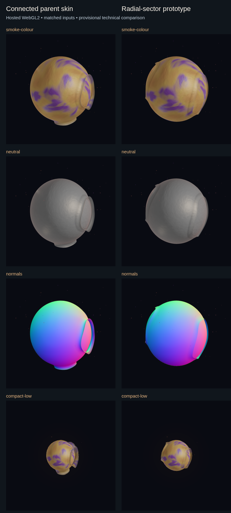

# Radial-shell graphical evidence — V-F2

2026-10-23. Isolated `feature/orb-appearance-foundation`, starting at
`15db3adaa30e29103d556a7354dd9440af957f72`. Integration dev remains
`cc69bc2b90eac4068c929af4beb1bb95705b14af`; published v0.2.5 remains
`dc64c5d180fb44cf7a29bf4d0d1ae2f853347709`.

## Disposition

Both skins execute through actual hosted WebGL2 and produce all 28 matched views.
The radial prototype has shallower, less rolled rims, but several views still read
as a coated sphere with casing-like openings. Compact Low has visible corners.
This is not a demonstrated overall artistic improvement or owner acceptance.
**Keep `living-connected` as default; retain radial as an internal experiment.**

The strict radial CPU/GPU point guard remains **failed**: maximum component error
0.0001060892 against 0.0001. Its normals and finite/error checks pass. Two bounded
hypotheses do not close that gap; no tolerance is relaxed and no shader workaround
is promoted as a repair. This is a reproducible evidence checkpoint, not a green
integration/release candidate. Standard CI is green on the rendered HEAD; an
earlier Windows owner-window timeout remains an unattributed intermittent observation.

## Review package

The left column is the current connected parent skin; the right is radial. This
sheet is made on the hosted runner from its actual WebGL pixels. It is not a CPU
projection, concept image or local render. The complete retained set includes
awkward/failing cases, not just selected attractive images.

| Read first | Parent | Radial |
| --- | --- | --- |
| Full colour, yaw 0 / curl 0 | [720px](evidence/orb-vf2/39988421329/colour-yaw0-curl0-living-connected.png) | [720px](evidence/orb-vf2/39988421329/colour-yaw0-curl0-radial-shell-experimental.png) |
| Full colour, yaw .75 / curl 6 | [720px](evidence/orb-vf2/39988421329/smoke-colour-living-connected.png) | [720px](evidence/orb-vf2/39988421329/smoke-colour-radial-shell-experimental.png) |
| Isolated skin | [720px](evidence/orb-vf2/39988421329/skin-only-living-connected.png) | [720px](evidence/orb-vf2/39988421329/skin-only-radial-shell-experimental.png) |
| Attachment diagnostic | [720px](evidence/orb-vf2/39988421329/attachment-living-connected.png) | [720px](evidence/orb-vf2/39988421329/attachment-radial-shell-experimental.png) |
| Compact Low | [720px](evidence/orb-vf2/39988421329/compact-low-living-connected.png) | [720px](evidence/orb-vf2/39988421329/compact-low-radial-shell-experimental.png) |
| Material at 300 seconds | [720px](evidence/orb-vf2/39988421329/material300-living-connected.png) | [720px](evidence/orb-vf2/39988421329/material300-radial-shell-experimental.png) |

All 28 original full-resolution views, the contact sheet, complete input/frame and
renderer metadata and failed test report are in [the final run folder](evidence/orb-vf2/39988421329).
[Integrity and checksums](evidence/orb-vf2/integrity.json) records every retained
file, PNG header dimensions, pair fairness and byte-identical body-only images.
The [first rendered failure and sheet](evidence/orb-vf2/39983691610) and
[worst-sample rerun](evidence/orb-vf2/39984683127/evidence.json) remain intact.
Downloaded source images were inspected as existing files; no local rasterization,
browser, WebGL, Sam, provider, model or audio process was launched.

## V-F1 closure audit

The final three V-F1 commits `f408918` → `7f5101e` → `15db3ad` have the expected
ancestry. The closing commit has assets/docs/evidence and no post-build production
input. Starting default selection is `living-connected`; the alternative is
internal/reversible. The compact outward-rim test samples actual surface normals,
seeds and phase wraps. Fresh compatibility/radial checks passed 21 cases. No missing
post-build implementation is established. Later broad CI exposed historical visual
formatting and exhaustive-test overhead, addressed below.

The starting 73-input clean build at `7f5101eab088d680b0e8379a64f7e4d3de7a3885`
has LF digest `e95e1edc6e5f68b3d1b99b142ba5fabab153c7ba09f355d655c1cb52dd33c73b`:
`index-BoytXu27.js` / `index-Brem5iPs.css`. [V-F1](ORB_APPEARANCE_VF1.md) retains
its historical source/resource proofs. The current build below supersedes it.

## Hosted execution and reproducibility

[Final graphical run](https://github.com/AlfonsoFR2020/sam-ambient/actions/runs/39988421329)
uses rendered HEAD `5ab659e55f0b497bb3307c0ec00b6b5bab8e3cb2`, Ubuntu 22.04,
Chromium 153.0.8010.12 via locked Playwright 1.63.0. Reported renderer:
`ANGLE (Google, Vulkan 1.3.0 (SwiftShader Device (Subzero) (0x0000C0DE)), SwiftShader driver)`.
It establishes software WebGL2 execution, not physical GPU cost or owner experience.

The single feature/path-scoped workflow is `.github/workflows/orb-graphical-proof.yml`.
It uses read-only contents permission, no persisted checkout credential, one
sandboxed browser worker, zero retries, a 15-minute job bound, three-minute browser
installation bound and six-minute graphics command bound. The fixture process has
an explicit credential-free environment and fresh temporary home; browser HTTP
requests are restricted to its loopback Vite fixture. No private session, owner
data or inference service is used. Browser sandboxing stays enabled; there are no
sysctl, AppArmor or workflow-protection changes. Locked browser installation happens
only remotely and retains the hosted image's existing system libraries.

`ui/playwright.orb-vf2.config.ts` refuses ordinary local execution. This prevents
accidents; it is not a security boundary against trusted source edits. The ordinary
CI workflow stays unchanged and may run on normal pushes; it publishes no release.
Experimental artifact retention is three days. The durable files above remain after
expiry; downloaded artifacts are data and are never executed locally.

`ui/tests/fixtures/orb-vf2.ts` defines seed `0x5a17`, 720×720, DPR 1, identical
frame/material/lighting/exposure/camera within every pair. Only skin strategy changes.
Curl 0/6/12 seconds advances travel by .3 radians/second with unrelated clocks held;
yaw is 0/.75/1.6. Material-only samples at 45/300 seconds hold those unrelated clocks.
After a full-colour High smoke pair, the fixture checks production skin equations,
then 13 paired cases: two additional yaw/curl views, neutral, normals, depth,
attachment, skin-only, body-only, compact .46, Low, compact Low, material 45/300.
This is a selected matrix, not every historical palette time or a motion video.

The fixture directly compiles the production WebGL backend and checks its source
against committed build inputs. It does not load the entire compiled React/owner
application. Both strategies must report actual WebGL2, GL error zero, nonblank
pixels and useful colour range. Per-view persistence retains a first capture even
if its counterpart fails. All final pairs have identical input/frame objects by
value; body-only PNG bytes are identical. Canvas fallback cannot satisfy the proof.

## Numerical results and repairs

Production transform feedback uses 192 position/normal samples per strategy across
four membrane phases, including both sides of a wrap. A controlled spheroid body
callback isolates skin math; real full-body/material execution is covered separately
by the rendered views. Errors below are maximum component errors, not angles.

| Strategy | Position | Normal | Collar q | Strict result |
| --- | ---: | ---: | ---: | --- |
| Parent | .00002316398 | .0005040753 | .00001507647 | Pass |
| Radial | .0001060892 | .001081367 | .0005810748 | Position fails .0001 |

Both have finite outputs, 23-bit reported vertex highp, zero GL error and 192 samples.
The radial worst point at travel 1.7 has CPU q .9999999513 versus GPU 1.0005810261.
Its captured x/y/theta coordinates differ by less than 8e-8, so the remaining gap
is downstream in the rim/collar chain, not explained by those coordinate values.
The exact arithmetic/transcendental source remains unresolved; a software-specific
precision cause has not been established as fact. No hardware extrapolation follows.

An equivalent prototype-only `atan(axis,length(equator,side))` latitude plus
arithmetic longitude wrap replaces a redundant trigonometric round trip. Its CPU
seam/polar equivalence regression passes, but hosted evidence disproves it as the
strict-gap repair. It is retained as a small equivalent simplification with no
claimed numerical/performance gain. Default equations/geometry snapshots still match.
A test-only `inversesqrt(sqrt(sum))` rim hypothesis also fails (~.0001062084 position);
it is clearly labelled in metadata, never selected by the production engine and
not substituted for production proof. Further numerical tuning stops here.

Hosted CI found a real test-cost defect: the exhaustive High deformation test
exceeded five seconds under parallel suite load. Aggregating finite/bound/unit
assertions retains every original vertex, triangle and sampled normal without
hundreds of thousands of assertion allocations. No timeout or coverage was loosened.
The resulting focused batch drops from 4.04 to 2.12 seconds (test evidence only).
Three pre-existing Ruff line-length findings in the baseline-preparation helper
were formatter-corrected with identical before/after Python syntax trees. Seventeen
existing visual formatting/import-order findings in eleven files were corrected;
unchanged default shader hashes and geometry arrays protect numerical behavior.

## Visual interpretation and limitations

The radial rim is shallower than the parent's rolled collars; isolated skin and
attachment views show substantial connected material rather than independent straps.
Pigment territories remain coherent across rest/lift and the material-only samples;
no palette, particle, radius-response, light or optical parameter tuning is added.
Normal/depth views show the sampled form and exposed-body separation without GL errors.
These are provisional engineering observations, not proof of every pose/overlap.

Several views still resemble rounded casing windows rather than broad radial shells.
In rich colour the film/body distinction can be subtle; some edges look cut or
panel-like. Compact Low has obvious corners/faceting. No topology replacement,
extra polygons, saturation increase or outline is used to conceal these shortcomings.
Dynamic translucency, all-view rim orientation, silhouette continuity through full
motion, lifecycle expression, Medium rendering and supported-hardware appearance
remain separate gates. The original concept board remains unavailable.

## Source, assets, cost and checks

One below-normal-priority canonical frontend build (`tsc -b && vite build`) completed
in 3.77 seconds without warnings at clean source
`1d03eacd77269f75539c12e704e97e401ab23b1b`. Current bundle: `index-DZgAZCHC.js`,
unchanged `index-Brem5iPs.css`. [All 73 inputs/artifacts](evidence/orb-vf2/frontend-assets.json)
match LF digest `ab27f92db63cbb8fdba91e33cd46fcd89a14e77e0a896b2b96928111d25f9139`.
No production input changed after that build; later edits are fixtures/docs/evidence.
The ordinary `Start Sam.cmd` private static-asset path resolves this bundle. It was
not launched. The old bundle is superseded. Settings, signals, clocks, cancellation,
quality, material and recovery contracts remain unchanged.

Source-array counts remain [V-F1's measured typed-array arithmetic](evidence/orb-appearance-vf1/geometry-comparison.json):

| Tier | Parent → radial body+skin vertices | Triangles | Geometry bytes including particles |
| --- | ---: | ---: | ---: |
| Low | 1,136 → 1,040 | 2,040 → 1,848 | 32,988 → 30,684 |
| Medium | 5,004 → 4,620 | 9,504 → 8,736 | 150,252 → 141,036 |
| High | 17,600 → 16,064 | 34,272 → 31,200 | 519,500 → 482,636 |

Both have one component, three boundary loops, Euler -1, six skin ranges, four
programs, seven buffers, 9/9/10 draws and 12/24/64 particle caps. Add 44 halo bytes
and 224/224/448 skin uniform bytes. No budget expansion or per-frame remeshing.
GPU median/p95, CPU submission, driver residency, power/thermal effects and full-app
inference coexistence are **unmeasured**. Capture duration is not GPU timing.

Final local source checks: **73 distinct frontend CPU cases** in ten files;
**21 Python file-only asset/public-documentation cases**; focused changed-file
Biome, project TypeScript and separate hosted-config TypeScript; Ruff/helper AST
check; source/artifact integrity and Git whitespace. Repetitions are not summed.
A whole-directory local Biome attempt failed after scanning ignored historical
baseline copies and unrelated CRLF files; it made no edits. Fresh hosted tracked-tree
lint is separate and passes on Ubuntu. No local graphics or full suites were run.

## Hosted failures and closure gates

| Run | Actual result |
| --- | --- |
| [39983022662](https://github.com/AlfonsoFR2020/sam-ambient/actions/runs/39983022662) | Rejected workflow: runner context unavailable in job env; moved path setup to a runner step |
| [39983241822](https://github.com/AlfonsoFR2020/sam-ambient/actions/runs/39983241822) | Current Ubuntu/AppArmor image had no usable Chromium sandbox; retained sandbox and selected Ubuntu 22.04 |
| [39983452379](https://github.com/AlfonsoFR2020/sam-ambient/actions/runs/39983452379) | Image Python 3.10 below Sam's 3.12 requirement; explicitly selected 3.12 |
| [39983691610](https://github.com/AlfonsoFR2020/sam-ambient/actions/runs/39983691610) | All 28 views; strict radial point guard fails; first sheet/failure retained |
| [39984683127](https://github.com/AlfonsoFR2020/sam-ambient/actions/runs/39984683127) | Reproduced collar discrepancy with worst-sample records |
| [39985734501](https://github.com/AlfonsoFR2020/sam-ambient/actions/runs/39985734501) | Cancelled stalled setup: apt font downloads retried for minutes; no render |
| [39986894338](https://github.com/AlfonsoFR2020/sam-ambient/actions/runs/39986894338) | Browser-only setup works; angular rewrite does not close strict gap; all views retained |
| [39987558589](https://github.com/AlfonsoFR2020/sam-ambient/actions/runs/39987558589) | Quarter-root hypothesis rejected; production guard remains failed |
| [39988421329](https://github.com/AlfonsoFR2020/sam-ambient/actions/runs/39988421329) | Final full set/component trace; production position guard still failed; all other render/finite/normal checks pass |

Ordinary [final-source CI at 5ab659e](https://github.com/AlfonsoFR2020/sam-ambient/actions/runs/39988421409)
is **green**: Ubuntu 817 Python passed / 44 skipped; Windows 856 passed / 5 skipped;
381 frontend tests plus lint/type/build pass on each platform. Package smoke and
the existing hosted Native package job also pass; neither publishes a release.
Platform counts overlap and are not summed. All full suites ran remotely.

Earlier [CI at df3901f](https://github.com/AlfonsoFR2020/sam-ambient/actions/runs/39985734673)
failed Windows `test_shipped_owner_ui_connects_and_submits_text`: Send was visible,
enabled/stable, then click timed out. The later run passes with the same production
source/bundle and no owner-window, timeout, provider or readiness repair. The
intermittent cause remains unattributed; green CI does not retrospectively solve it.
Standard CI success also does not pass the separate failed experimental proof.

Before integration review: resolve or rigorously bound the strict radial discrepancy
on a controlled renderer, retain the parent default, and separately retain/investigate
the intermittent Windows owner-window observation. Before radial promotion: demonstrate broad organic shell
character, smooth Low silhouettes and dynamic rich-colour optical continuity. Before
release: supported-hardware performance, full lifecycle/owner interaction, actual
conversation/audio and remaining distribution gates. No merge, version, software
release, theme programme or human beta is performed or requested.
