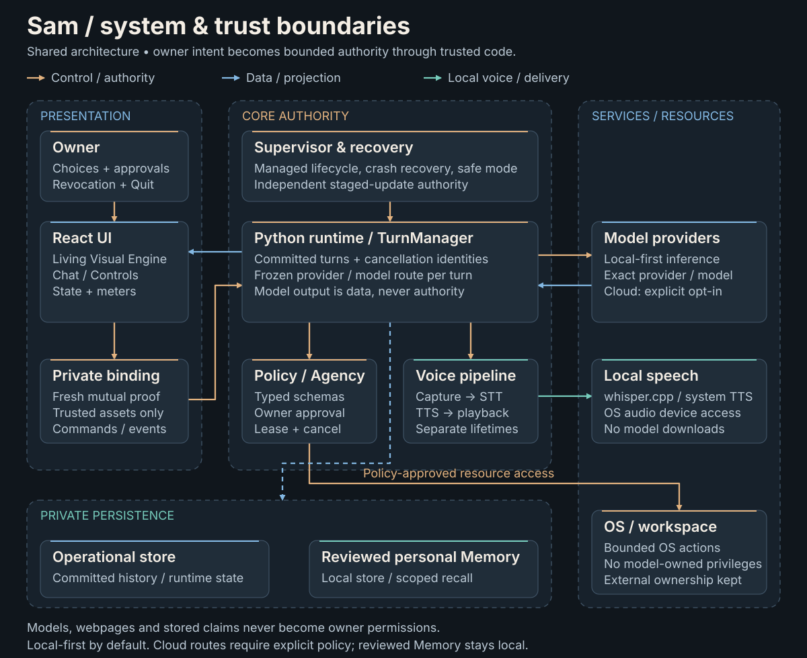
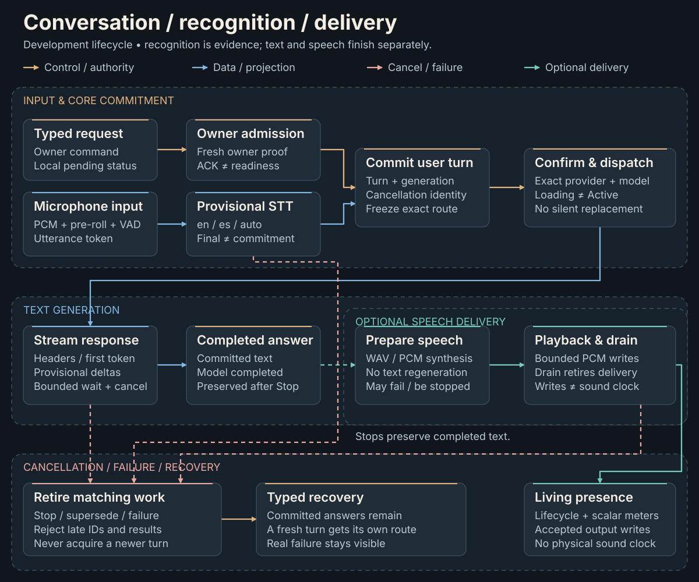

# Sam architecture diagrams

These original vector diagrams explain implemented boundaries. The system diagram
shows shared architectural foundations; the lifecycle diagram describes current
**unreleased `dev` behavior**, including playback-write observation. Neither image
is proof of graphical acceptance of Sam's Orb or of real acoustic timing.

## System architecture and trust boundaries



The owner interface projects trusted state through a private authenticated binding.
TurnManager owns committed turns and frozen model routes; policy mediates bounded
resource access. Operational records and reviewed personal Memory are separate.
Models, webpage contents and stored claims confer no owner permission.
The dashed blue runtime/Memory path represents mediated local recall and reviewed
data, never instructions or authorization. Local speech sends capture/recognition
back toward the runtime separately from synthesized output sent to local services.

## Conversation, recognition and delivery



Recognition remains provisional until core commitment. Command ACK is neither
commitment nor model readiness. Completed answer text and optional spoken delivery
retire separately; accepted PCM writes are an observation boundary, not a timestamp
for sound reaching a speaker or listener. Cancelled work cannot acquire a newer turn.
Each dashed rose transition terminates at matching-work retirement. Playback
observation follows the right-hand gutter and enters Living Presence from above.
Perpendicular crossings do not create junctions or transfer authority.

## Editable sources and conventions

- Source of truth: [`generate_architecture_diagrams.py`](../../scripts/generate_architecture_diagrams.py)
  contains content and explicit coordinates; standard-library generation adds no
  package, external font, raster image or diagramming dependency.
- Outputs are ordinary SVG with editable text/shapes, accessible `title` / `desc`
  and a scalable `viewBox`. Edit the generator first and regenerate; do not patch
  generated SVGs independently.
- Copper: control/authority. Blue: data/projection. Teal: local speech and optional
  delivery. Dashed rose: cancellation/failure; dashed teal: optional speech.
  Dashed containers mark trust/ownership groups; these are not network permissions.
- Layout uses Segoe UI / Inter / Arial / sans-serif, graphite surfaces and
  high-contrast text. Connectors are orthogonal, with separate success and recovery
  paths. The README uses only the system diagram to keep the landing page compact.

From the repository root, using the existing Python environment:

```sh
python scripts/generate_architecture_diagrams.py
python scripts/generate_architecture_diagrams.py --check
python -m pytest tests/unit/test_public_documentation.py
```

File-only checks parse XML, resolve marker IDs, reject executable/external content,
check node bounds/overlap and conservative text-width estimates, verify contrast
and compare outputs to their source. They also check prominent documentation links.
Text estimates are **not measured font layout**. No browser, SVG rendering or visual
inspection was authorized in V-B; actual layout/readability at GitHub width remains
a later visual-review gate. Do not equate structural checks with rendered approval.

For module contracts and the exact implementation, see
[Architecture](../ARCHITECTURE.md), [recognition evidence](../SPEECH_RECOGNITION_VB.md)
and [public documentation scope](../PUBLIC_DOCUMENTATION_VB.md).
